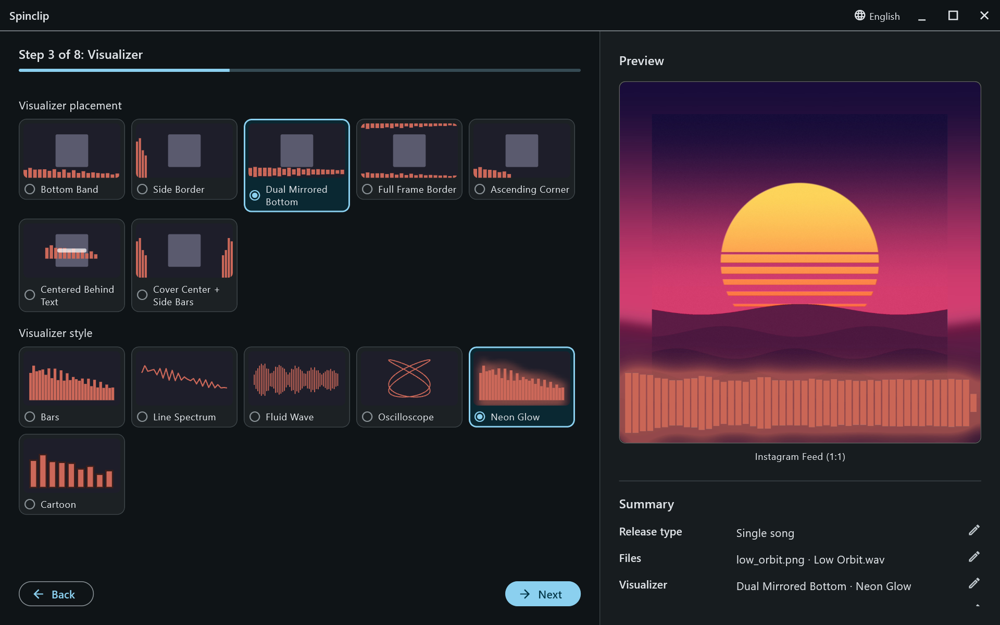

# Spinclip

Promo videos for music releases, from a cover image and a song: the cover over a blurred,
stretched copy of itself, with an FFmpeg-rendered visualizer that moves to the music — sized for
YouTube, Instagram, TikTok, Facebook and Spotify Canvas in one render.

**[spinclip.bandpassrecords.com](https://spinclip.bandpassrecords.com)** — downloads, examples
and the [user guide](https://spinclip.bandpassrecords.com/guide/overview/).



## Development

A Flutter desktop app (Windows, macOS, Linux). The GUI and `bin/render_cli.dart` drive the same
render pipeline (`lib/services/filtergraph_builder.dart`).

```bash
flutter pub get
flutter run -d windows      # or macos, linux
flutter analyze && flutter test
```

- [RELEASING.md](RELEASING.md) — versioning and the release workflow.
- [website/README.md](website/README.md) — the website, and where its pictures come from.
- `scripts/capture_screenshots.ps1` — retakes the website's screenshots and example videos from
  the real app, on a demo release it generates itself.
- `resources/tools/README.md` — the bundled ffmpeg.
