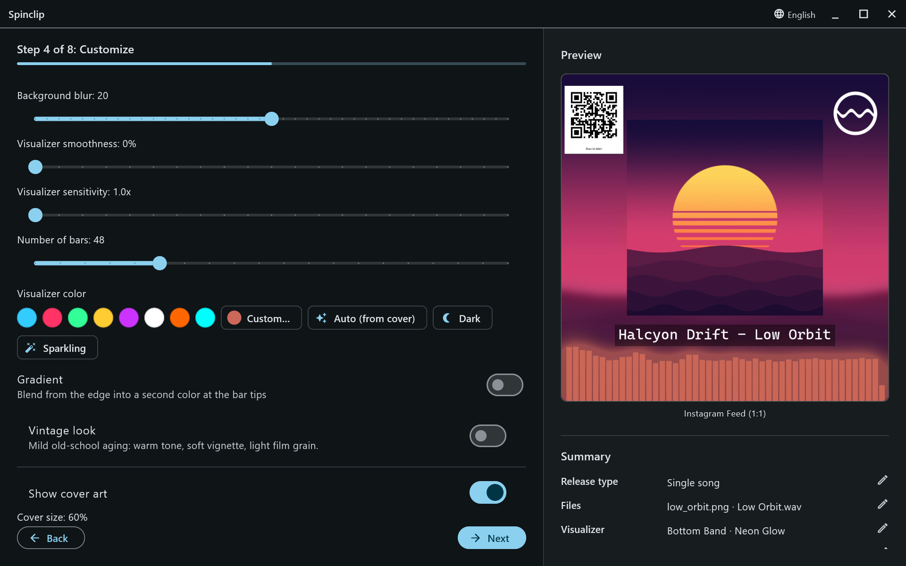
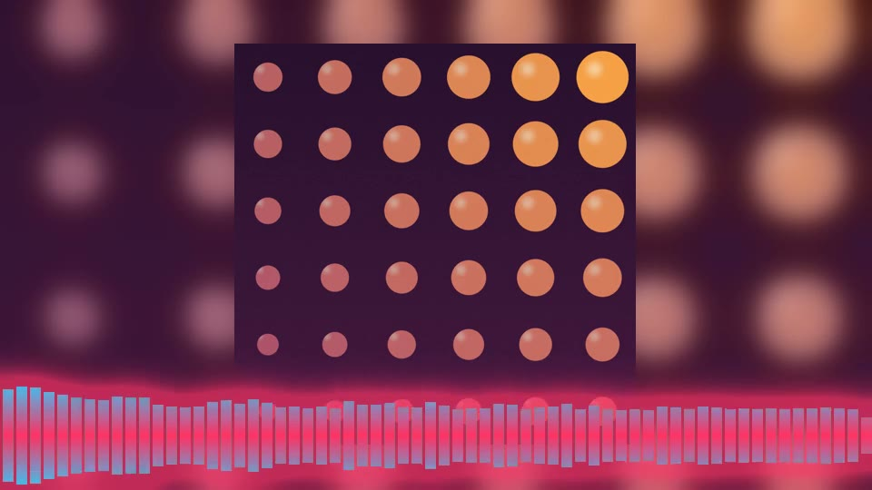
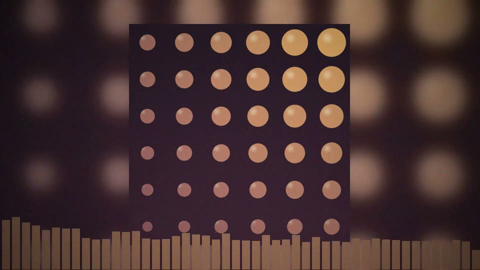
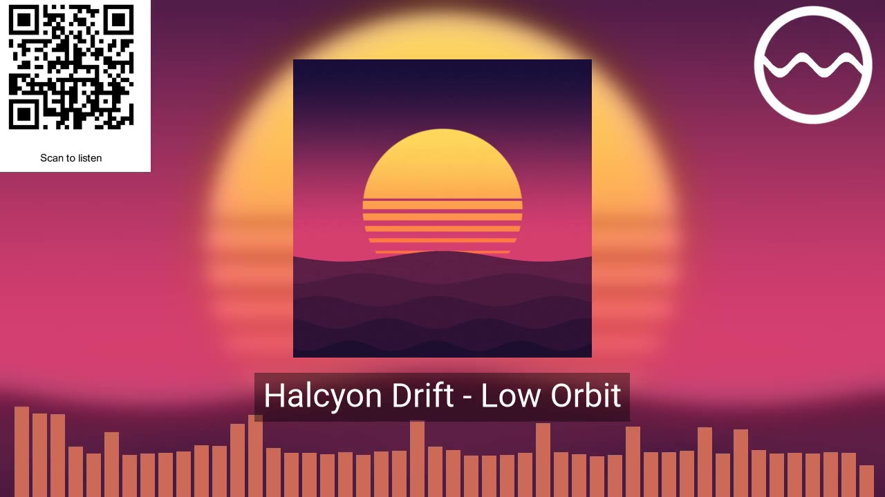

An **Advanced settings** step: everything about the look beyond the visualizer's placement and style. The preview updates as you go.

## The visualizer

- **Background blur** (0–40): how soft the stretched copy of the cover behind everything is. 20 by default.
- **Visualizer smoothness** (0–100%): how much the bars are averaged over time. 0% bounces fastest; higher is calmer.
- **Visualizer sensitivity** (1–3×): zooms in on the loudness range, so quiet music reaches higher.
- **Number of bars**: **Auto**, or 16 to 160 in steps of 8. 48 by default.

## Colour

- **Swatches** for eight ready colours, and **Custom…** for any colour: a saturation and brightness square, a hue strip and a hex field.
- **Auto (from cover)** picks the cover's most striking colour.
- **Dark** (a deep purple) and **Sparkling** (gold) are one-click moods.
- **Gradient** blends from the edge of the frame into a second **tip colour** at the end of each bar (for the Fluid Wave: edge, centre, edge).

## Vintage look

A mild old-school aging over the whole frame: a warm tone, a soft vignette and light film grain.

## Cover art

**Show cover art** draws the sharp cover over the background; **Cover size** sets it as a share of the frame's shorter side (20–100%, 82% by default). Turn it off for a full-frame blurred look.

## Logo, title and QR code

- **Show logo**: pick a PNG (transparency is kept) — your label's mark, say.
- **Show text overlay**: a line of text, such as the artist and title.
- **Show QR code**: a code that opens a link of your choice, like the release's streaming page, with an optional caption **below** or **above** it ("Scan to listen").

## Position & rotate

At the bottom of the step, a canvas in the shape of the first selected platform holds a handle for the cover, the logo, the text and the QR code. **Drag** a handle to move it; **tap** the logo or QR code to rotate it. **Reset positions** puts everything back.

## Fades

**Fade in** and **Fade out** (0–10 seconds) fade the picture and the sound together at the start and end of each video.
