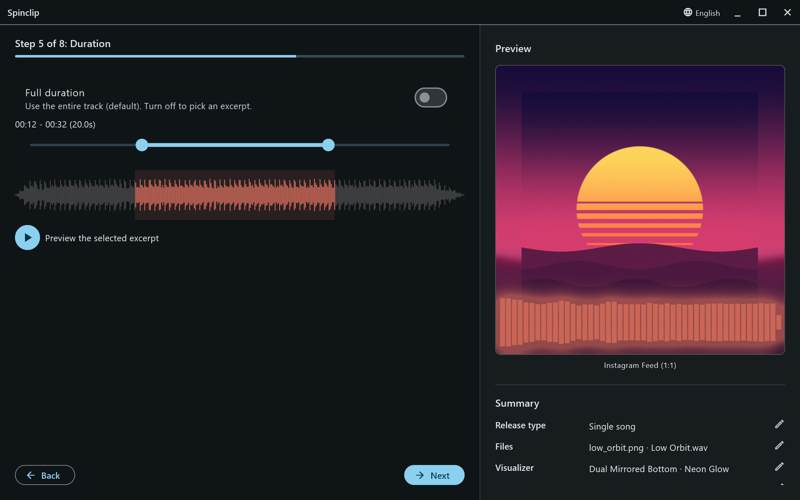

An **Advanced settings** step, for single songs. (For a medley, each song's excerpt is set on the [Files](/guide/files/#multiple-songs-and-medleys) step.)

- **Full duration**, on by default, renders the entire song.
- Turn it off to pick an **excerpt**: drag the two ends of the range. The label shows the start, the end and the length; the waveform highlights the part that will play.
- **Preview the selected excerpt** plays just that part.

Short excerpts render fast, and suit Reels, Stories and TikTok.

## Spotify Canvas

Spotify Canvas videos are always a short **8-second loop**, whatever this step says: Spotify asks for a loop of 3 to 8 seconds. The other platforms in the same render follow this step as usual.
