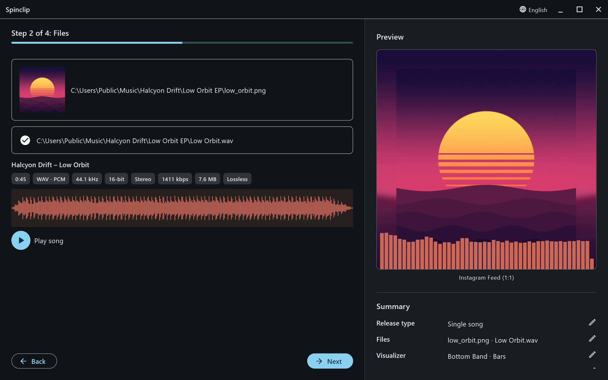
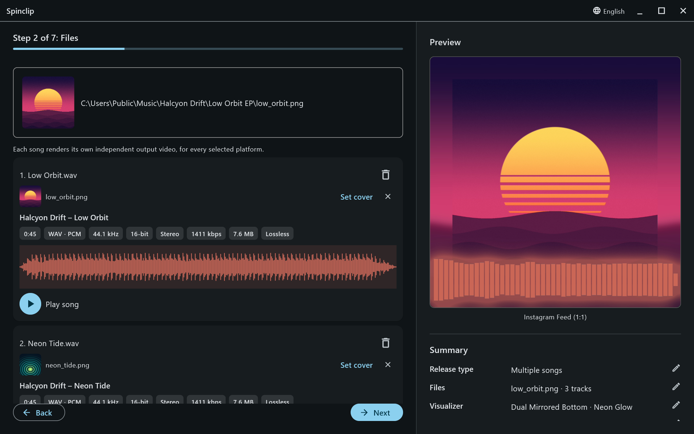
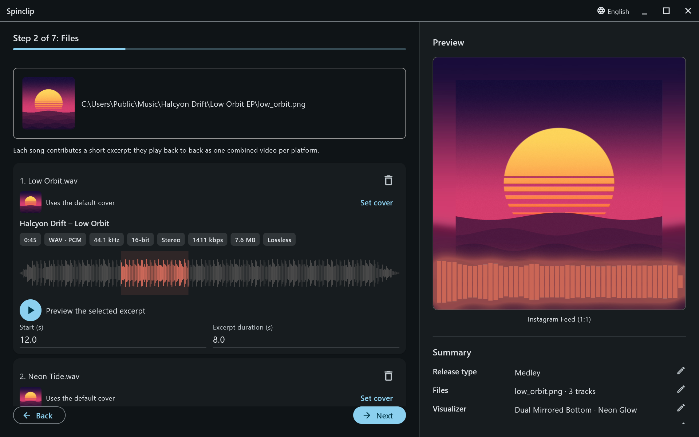

## Cover image

PNG or JPG. Click the box to pick a file, or drop one on it. The cover is drawn sharp in the middle of the frame and, blurred and stretched, as the background behind it. A square image of at least 1080×1080 looks best; Spinclip never scales the sharp cover past the image's own resolution.

## Audio

WAV, MP3, FLAC, OGG, AIFF or M4A. Once picked, Spinclip reads the song and shows:

- its **title and artist**, when the file has them;
- **length, format and codec, sample rate, bit depth, channels, bitrate and file size**, and whether it's **lossless** or **lossy**;
- its **waveform**, in the visualizer's colour, and a **Play song** button.

**Next** waits until the cover and the audio are both there.

## Multiple songs and medleys

For [multiple songs or a medley](/guide/release-types/), the cover box becomes the **default cover**, and **Add song** adds songs to a list — several at once if you select several files.

Each song in the list shows its details and waveform, and:

- **Set cover** gives that song its own cover; **×** goes back to the default.
- The **bin** removes it from the list.
- In a medley, **Start** and **Excerpt duration** (in seconds) pick the part of the song that plays; the waveform highlights it.

The preview shows the first song in the list.
