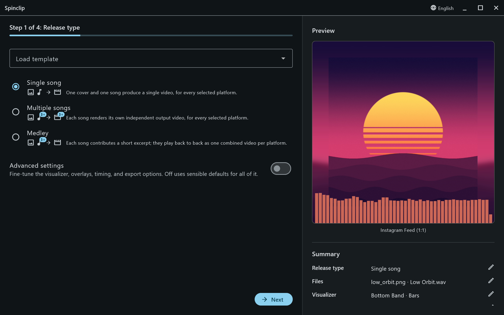
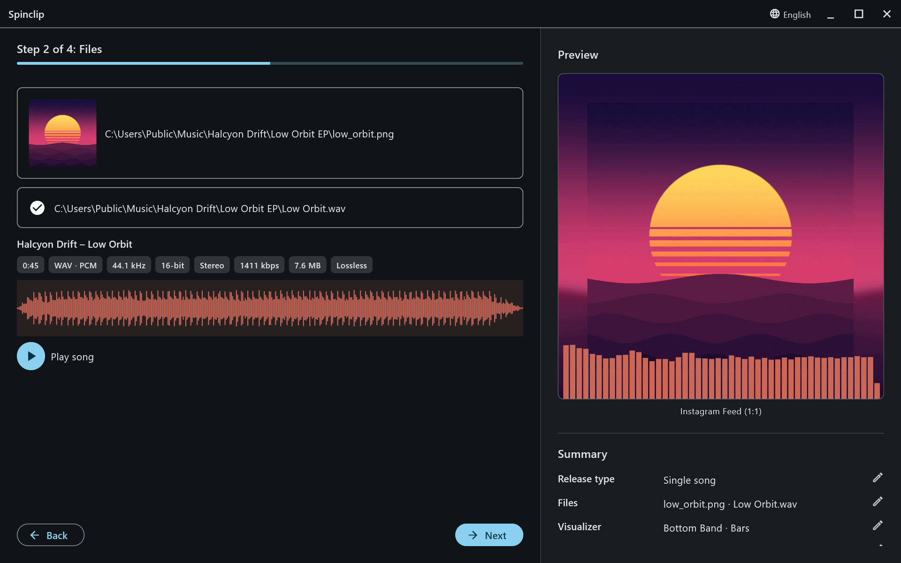
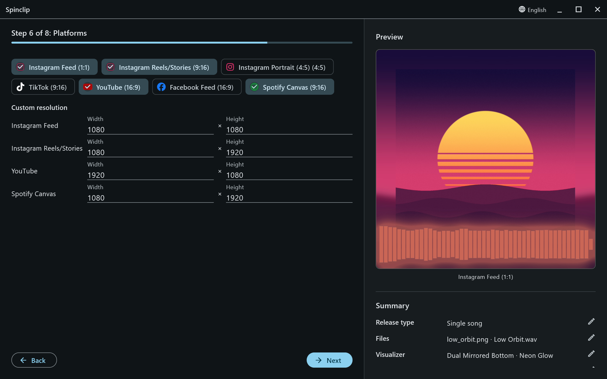
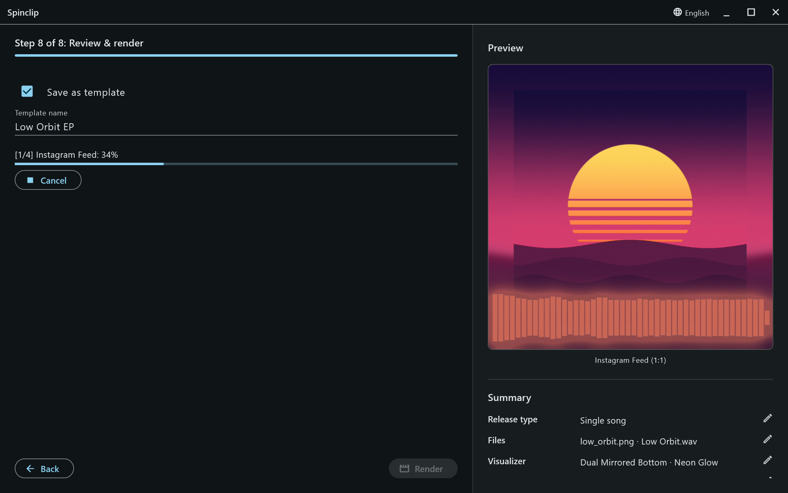

The easy path takes four steps and leaves everything else at its default. You can always come back and change things — the preview follows every change.

## 1. Release type

Leave **Single song** selected and press **Next**. ([More on release types](/guide/release-types/).)

## 2. Files

Click the first box (or drop a file on it) to pick the **cover image** — PNG or JPG, square works best. Then pick the **audio file**: WAV, MP3, FLAC, OGG, AIFF or M4A.

Spinclip shows the song's details — length, format, sample rate, bit depth, channels, bitrate, size — with its waveform and a **Play song** button. The preview on the right renders its first frame.

**Next** stays disabled until both files are in.

## 3. Platforms

Tick every platform the release goes out on. Each one gets its own video, laid out for its shape. ([The platforms and their sizes](/guide/platforms/).)

## 4. Review & render

Check the **Summary** on the right and press **Render**. A progress bar follows each platform in turn; **Cancel** stops it.

When it's done, **Open folder** shows the videos. By default they're in `Documents/Spinclip/<cover name>/`.

## Next

- Change the look: turn on **Advanced settings** on the first step, then see [Visualizer](/guide/visualizer/) and [Customize](/guide/customize/).
- Use only part of the song: [Duration](/guide/duration/).
- A whole EP at once: [Release type](/guide/release-types/).
