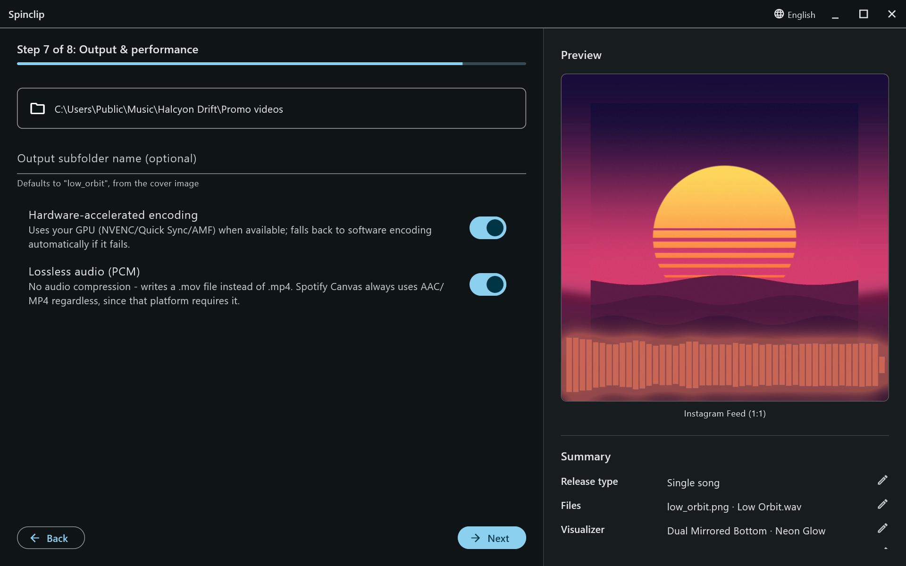

An **Advanced settings** step. With it off, everything here keeps its default.

## Output folder

Videos go to **Documents/Spinclip** unless you pick another folder. Inside it, each release gets **a folder of its own**, named after the cover image (`low_orbit.png` → `low_orbit/`), so two releases never overwrite each other. Type an **Output subfolder name** to call it something else.

If that folder already has videos from an earlier render, Spinclip asks before overwriting them.

The files are named after the platform:

| Release type | File names |
|---|---|
| Single song | `output_youtube.mov`, `output_tiktok.mov`, … |
| Multiple songs | `output_youtube_<song>.mov`, … — one per song and platform |
| Medley | `medley_youtube.mov`, … |

They're `.mp4` instead of `.mov` with lossless audio off — and always for Spotify Canvas.

## Hardware-accelerated encoding

On by default. Spinclip encodes on your graphics card when it can — NVIDIA (NVENC), Intel (Quick Sync) or AMD (AMF) — which is much faster. If the GPU encoder isn't there or fails, it falls back to software encoding on its own.

## Lossless audio

On by default. The song goes into the video **uncompressed (PCM)**, so it sounds exactly like your master — in a `.mov` file, since MP4 doesn't carry PCM audio reliably. Turn it off for smaller `.mp4` files with AAC audio. Platforms re-encode the sound when you upload either way; lossless means the first generation of compression is theirs, not Spinclip's.
