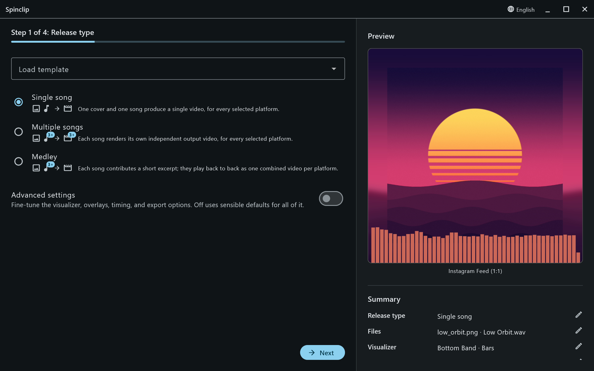

Spinclip makes promo videos for music releases. Give it a cover image and a song; it renders a video with the cover over a blurred, stretched copy of itself and a visualizer that moves to the music — sized for each platform you pick.

Everything happens on your computer. Spinclip drives [FFmpeg](https://ffmpeg.org), which it brings along on Windows and macOS: there's no account, no upload and no watermark.

## The wizard

Spinclip is one window: a wizard on the left, and a **live preview** on the right that shows a real frame of the video you're making. Below the preview, the **Summary** lists every choice; its pencil buttons jump straight to the step that sets it.

By default the wizard has four steps — the easy path:

1. [Release type](/guide/release-types/) — one song, several songs, or a medley.
2. [Files](/guide/files/) — the cover image and the song(s).
3. [Platforms](/guide/platforms/) — where the videos are going.
4. [Review & render](/guide/render/).

Everything else uses a sensible default: Bars, 48 of them, along the bottom, in cyan, over the whole song. Turn on **Advanced settings** on the first step and four more steps appear: [Visualizer](/guide/visualizer/), [Customize](/guide/customize/), [Duration](/guide/duration/) (single songs only) and [Output & performance](/guide/output/).

## What you get

One video per platform you tick — or, for several songs, one per song per platform — in a folder named after the release. See [Output & performance](/guide/output/) for where they go and what they're called.

New here? Start with [installation](/guide/installation/), then [your first video](/guide/first-video/).
