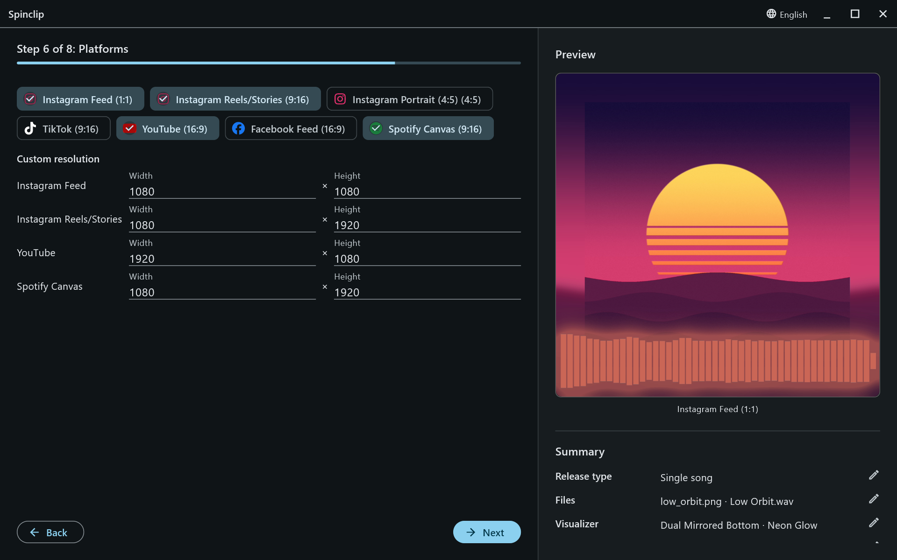
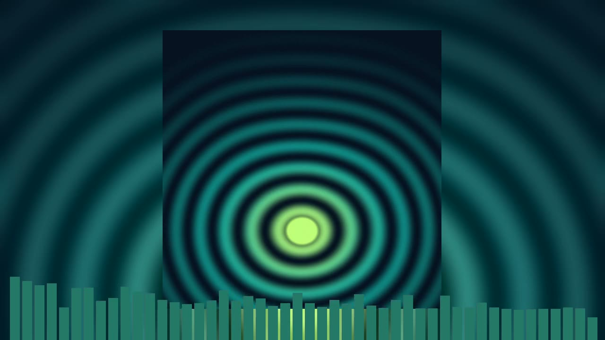
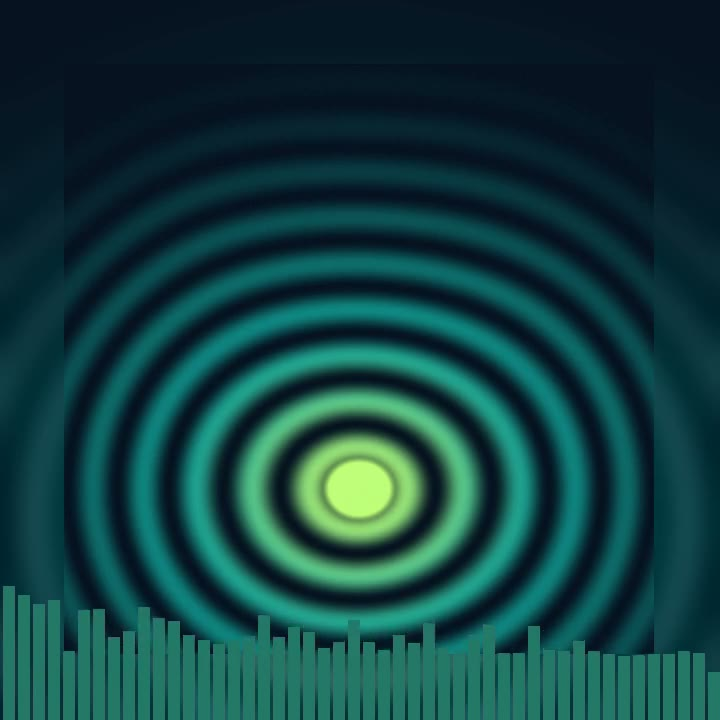
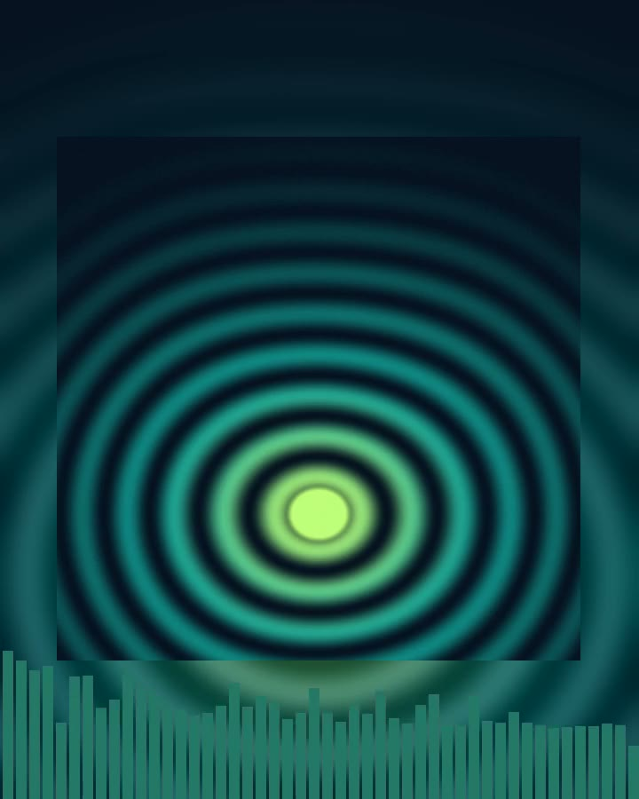
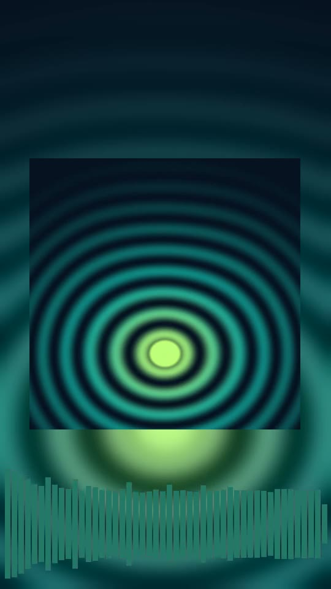

Tick every platform the release goes out on: each gets its own video from the same settings, laid out again for its shape — not a crop of one video. The preview shows the first one you ticked.

| Platform | Shape | Size |
|---|---|---|
| Instagram Feed | 1:1 square | 1080 × 1080 |
| Instagram Reels/Stories | 9:16 vertical | 1080 × 1920 |
| Instagram Portrait | 4:5 portrait | 1080 × 1350 |
| TikTok | 9:16 vertical | 1080 × 1920 |
| YouTube | 16:9 landscape | 1920 × 1080 |
| Facebook Feed | 16:9 landscape | 1920 × 1080 |
| Spotify Canvas | 9:16 vertical, 8-second loop | 1080 × 1920 |

<figure><figcaption><b>16:9</b> — YouTube, Facebook</figcaption></figure>
<figure><figcaption><b>1:1</b> — Instagram Feed</figcaption></figure>
<figure><figcaption><b>4:5</b> — Instagram Portrait</figcaption></figure>
<figure><figcaption><b>9:16</b> — Reels, Stories, TikTok, Spotify Canvas</figcaption></figure>

Spotify Canvas is always an MP4 with AAC audio, as Spotify requires, even when [lossless audio](/guide/output/#lossless-audio) is on.

## Custom resolution

With **Advanced settings** on, a **Custom resolution** table lists each ticked platform's width and height. Change them to render at another size — 4K for YouTube, say, or 720p for a quick draft. The reset button next to a row brings back the platform's own size.
