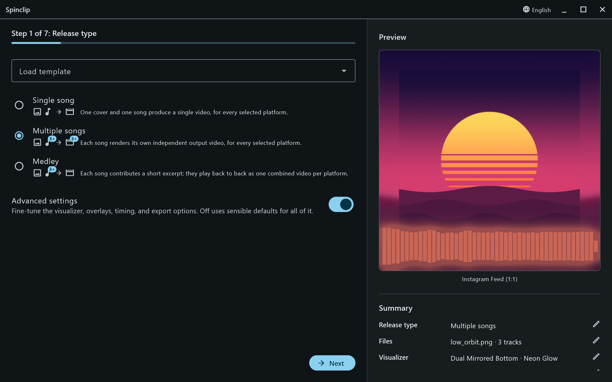

The first step decides what the render makes. Each choice has a small diagram of what goes in and what comes out.

## Single song

One cover and one song make **one video for every platform** you tick.

## Multiple songs

Several songs, each rendered as **its own independent video**, for every platform: three songs and four platforms make twelve videos. Use it for an EP or album where every track gets a visualizer.

Each song can use the **default cover** or a cover of its own — see [Files](/guide/files/#multiple-songs-and-medleys).

## Medley

Several songs contribute **a short excerpt each**; the excerpts play back to back as **one combined video per platform**. It's the teaser for a whole release. Each excerpt is 8 seconds unless you change it, and a medley needs at least two songs.

## Also on this step

- **Load template** applies a saved look in one go — see [Templates](/guide/templates/).
- **Advanced settings** reveals the steps for the visualizer, colours and overlays, timing and export. Off, everything uses sensible defaults.
