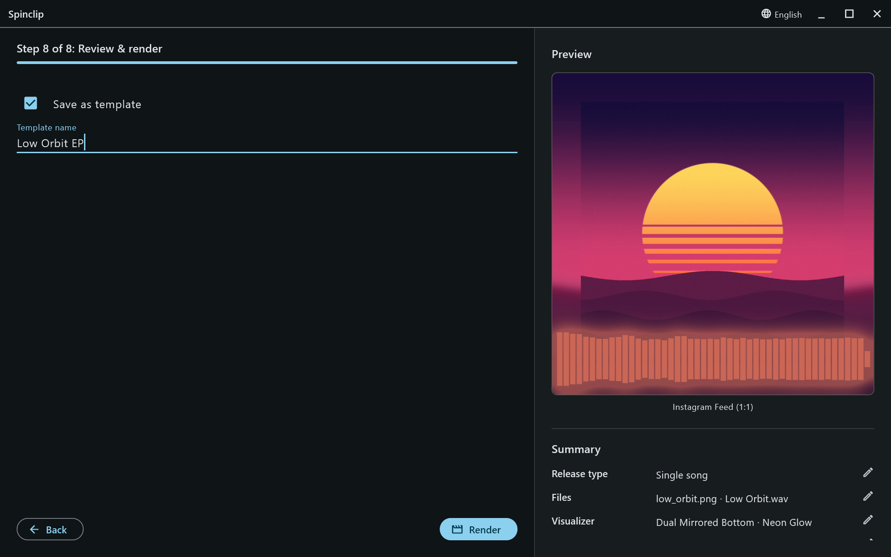
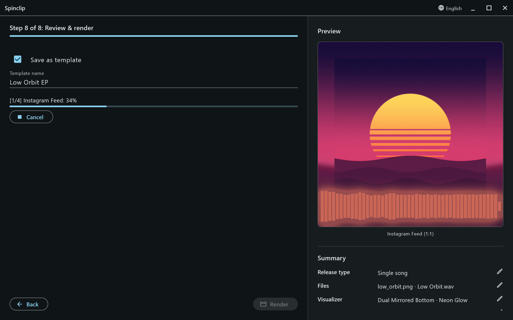

The last step. The **Summary** on the right lists every choice — release type, files, visualizer, customizations, duration, platforms and output — and each row's pencil jumps back to the step that sets it, turning on Advanced settings if it has to.

## Save as template

Tick **Save as template** and give it a name to keep this look for the next release. It's saved when you press **Render**. See [Templates](/guide/templates/).

## Render

**Render** starts. The progress bar shows which video is being made — `[1/4] Instagram Feed: 42%` — and **Cancel** stops the render.

When it's finished, Spinclip says where the videos were saved, and **Open folder** shows them.

How long it takes depends on the song's length, the number of platforms and your computer — see [A render is slow](/guide/troubleshooting/#a-render-is-slow).
