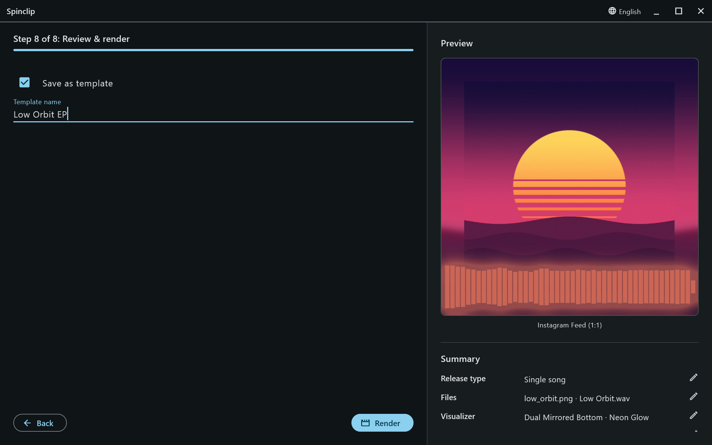

A template keeps everything about the **look** of a render — release type, visualizer placement and style, colours and gradient, blur and motion, cover, logo, text and QR code settings and positions, fades, vintage, platforms and their resolutions, and the performance settings — but not the cover or the songs. Load it on the next release and only the files change.

## Saving one

On [Review & render](/guide/render/), tick **Save as template**, type a name, and press **Render**: the template is saved as the render starts. A template with the same name is replaced.

## Loading one

On the first step, open **Load template** and pick one. Its settings apply at once, and the preview follows.

**Spinclip default (Bars 48)** is always there: it puts every setting back to how a new release starts.

## Deleting one

Select it in **Load template** and press the **bin** next to the list. The built-in default can't be deleted.

Templates are kept on your computer, in Spinclip's application-support folder (`templates.json`).
