An **Advanced settings** step. Placements and styles are picked from cards drawn in your current colour; the preview shows the result on your artwork.

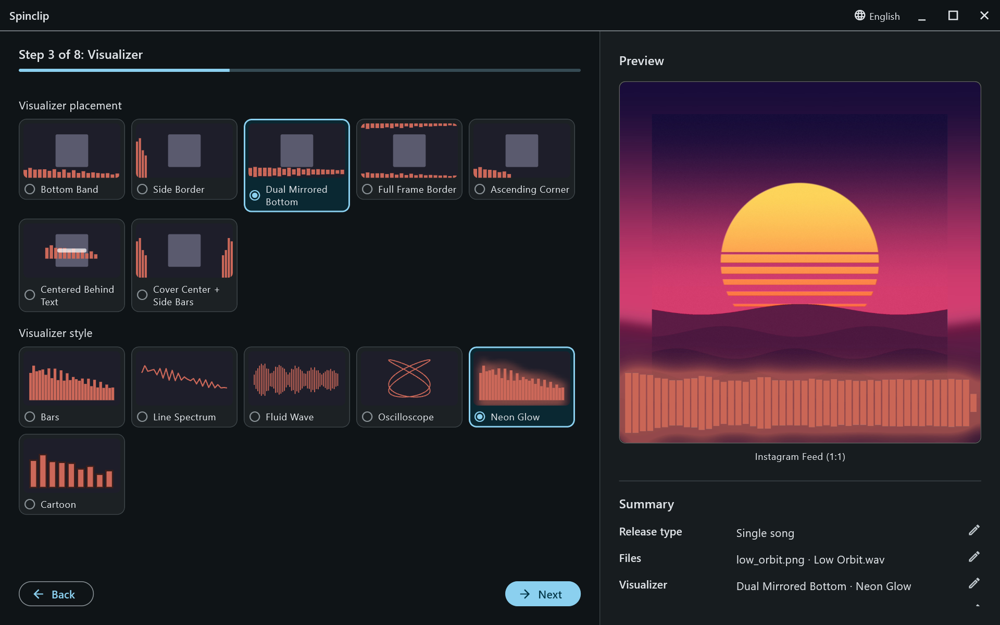

## Placement

Where in the frame the visualizer goes.

<figure>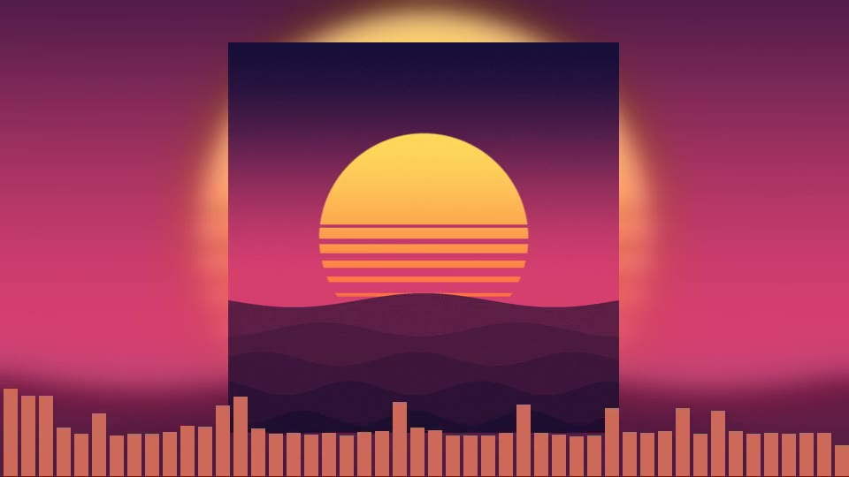<figcaption><b>Bottom Band</b> — along the bottom edge. The default.</figcaption></figure>
<figure>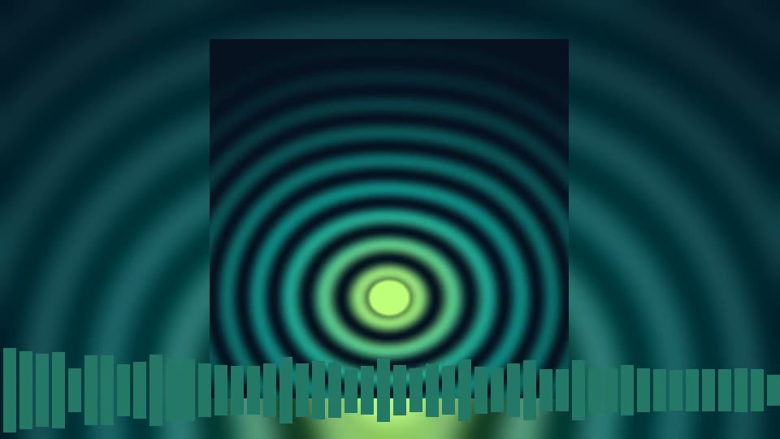<figcaption><b>Dual Mirrored Bottom</b> — reflected up and down from a line near the bottom.</figcaption></figure>
<figure>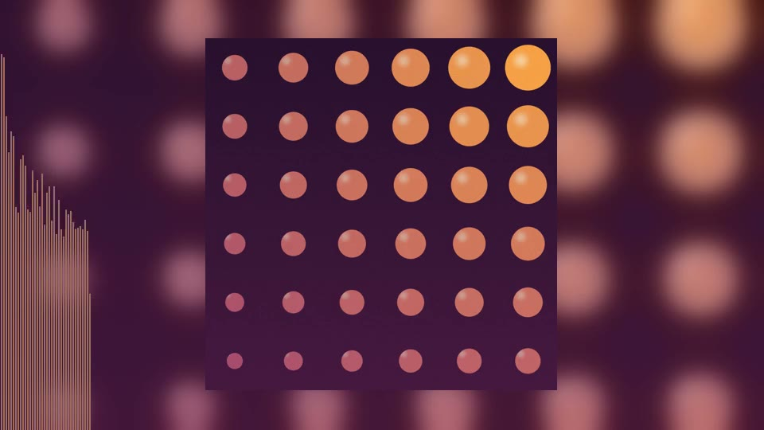<figcaption><b>Side Border</b> — up the left edge.</figcaption></figure>
<figure>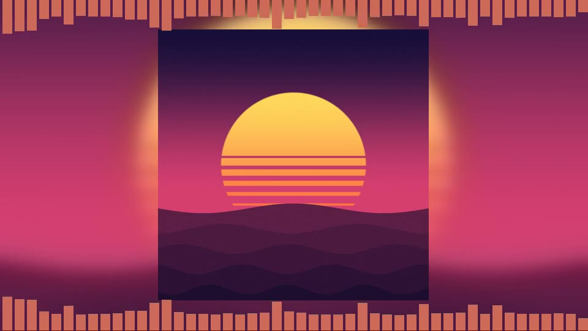<figcaption><b>Full Frame Border</b> — top and bottom edges.</figcaption></figure>
<figure>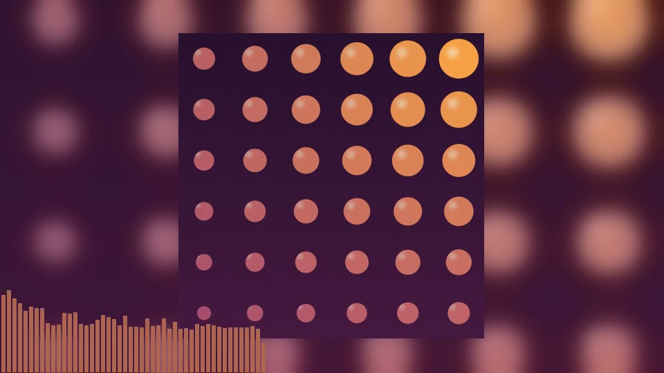<figcaption><b>Ascending Corner</b> — a compact meter in the corner.</figcaption></figure>
<figure>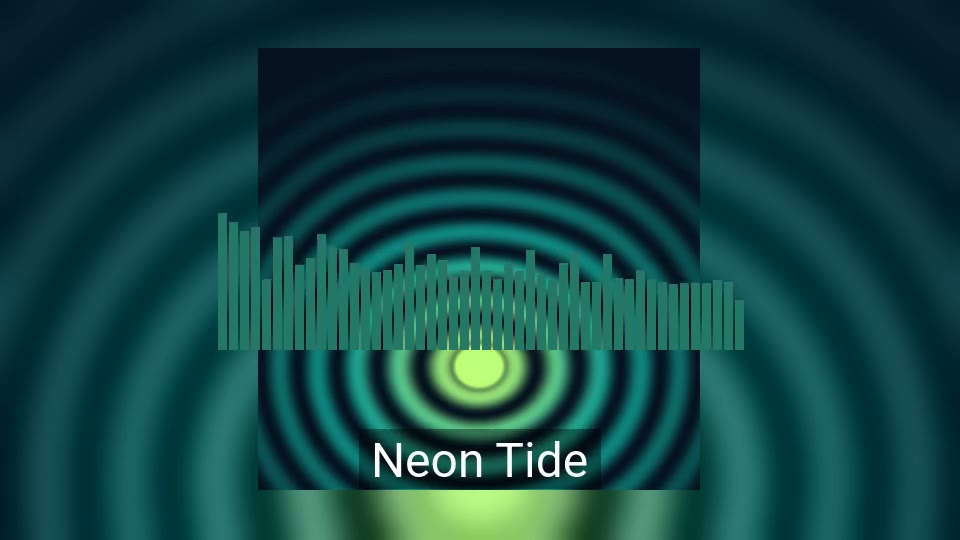<figcaption><b>Centered Behind Text</b> — mid-frame, behind the title.</figcaption></figure>
<figure>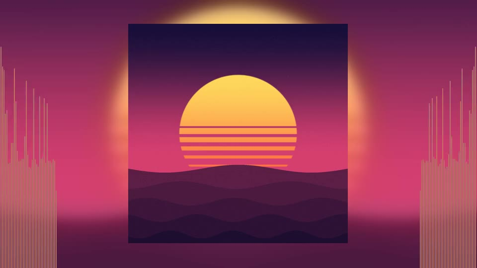<figcaption><b>Cover Center + Side Bars</b> — columns either side of the cover.</figcaption></figure>

## Style

How the music is drawn.

<figure>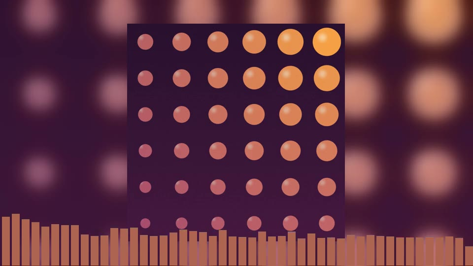<figcaption><b>Bars</b> — the spectrum as bars. The default.</figcaption></figure>
<figure>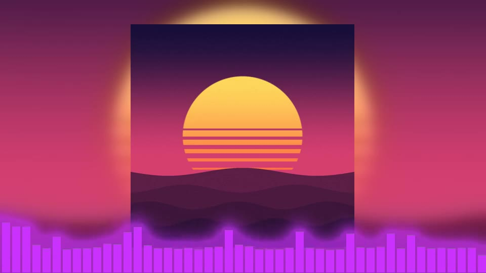<figcaption><b>Neon Glow</b> — bars with a glow spilling onto the background.</figcaption></figure>
<figure>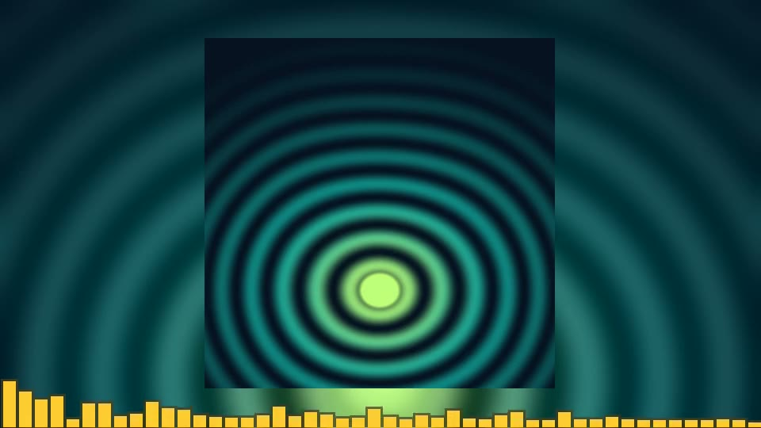<figcaption><b>Cartoon</b> — chunky bars with a darker outline.</figcaption></figure>
<figure>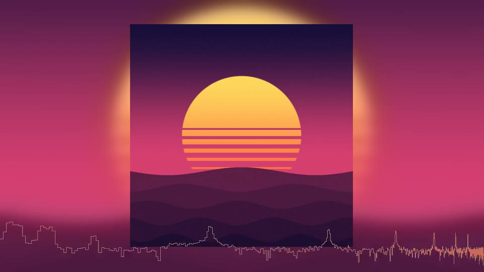<figcaption><b>Line Spectrum</b> — the spectrum as one line.</figcaption></figure>
<figure>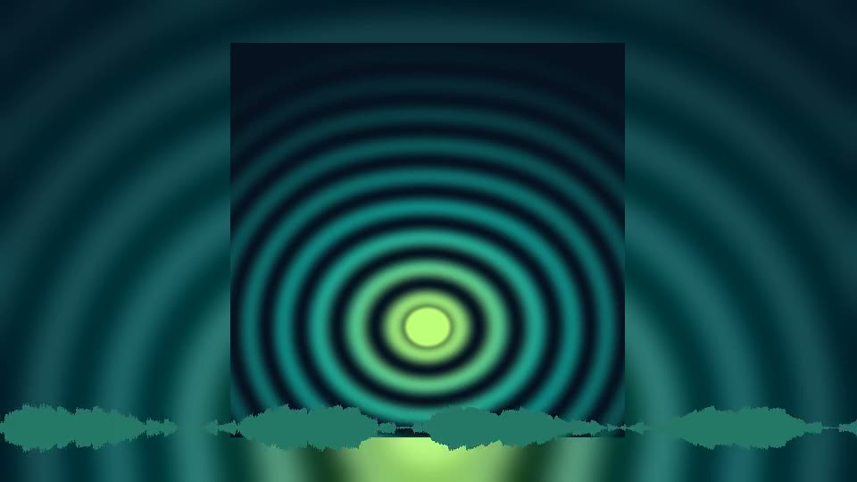<figcaption><b>Fluid Wave</b> — the waveform, mirrored around a centre line.</figcaption></figure>
<figure>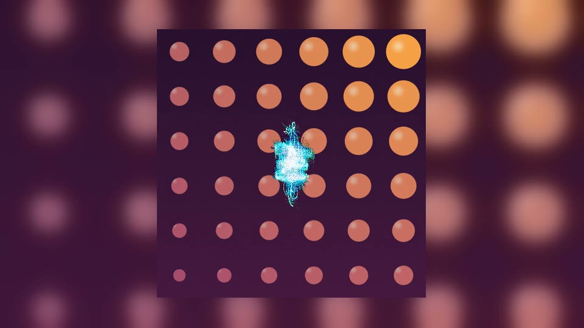<figcaption><b>Oscilloscope</b> — the stereo image as a vector scope, in its own colours.</figcaption></figure>

The spectrum styles cover 60 Hz to 16 kHz on a musical (logarithmic) scale, so the bass doesn't crowd into one bar on the left. The number of bars, how fast they bounce and how tall they reach are on the [Customize](/guide/customize/) step.
